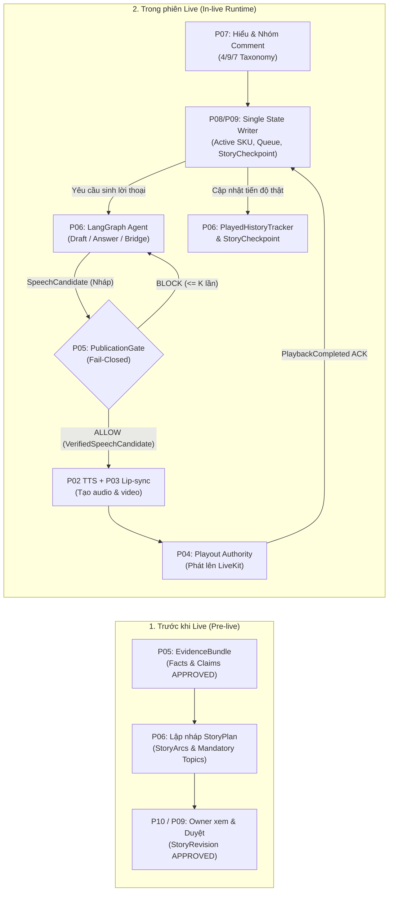

# Hướng dẫn Nhiệm vụ & Cấu trúc Thư mục Module P06 (`autonomous-storytelling`)

> **Dành cho:** Thành viên mới, Product Owner, Reviewer và AI Coding Agents bắt đầu làm việc với module **P06 — Sales Intelligence & Autonomous Storytelling**.  
> **Trạng thái hiện tại:** `IN RESEARCH` (Đã xong phần khung và tài liệu nghiên cứu; mã nguồn Python `src/p06/` và các thí nghiệm `P06-E01`..`P06-E04` đang ở trạng thái `NOT STARTED`).

---

## 1. Bức tranh tổng thể: P06 làm gì trong HOSTRA AI?

Trong phạm vi MVP (`ACR-002`), HOSTRA AI vận hành **01 phòng livestream riêng tư (private live room)** kéo dài **1–2 giờ**, giới thiệu **2–5 SKU thực phẩm đóng gói** đã đạt chứng nhận `OCOP: VERIFIED` và an toàn thực phẩm. Khi phát trực tiếp, lượng bình luận của người xem không đều: có lúc nhiều phút không có ai hỏi, có lúc dồn dập hàng chục câu hỏi lặp lại về giá, hạn sử dụng, chứng nhận OCOP hoặc công dụng.

- Nếu AI **chỉ trả lời khi có comment**, phiên live sẽ bị "đứng hình" (`HOST_IDLE`) trong các khoảng lặng.
- Nếu AI **đọc thuộc lòng một kịch bản soạn sẵn**, người xem sẽ nghe lặp đi lặp lại trong 1–2 giờ và mạch kể dễ bị đứt gãy mỗi khi phải trả lời câu hỏi bất ngờ.

**Nhiệm vụ của P06** là đóng vai trò *"bộ não biên kịch & dẫn chuyện có kiểm soát"*:
1. **Trước giờ live (Pre-live):** Dựa trên mục tiêu của merchant và dữ liệu đã duyệt từ `P05`, lập bản nháp `StoryPlan` (chia thành các `StoryArc` và `mandatory_topics`) để **Owner xem trước và bấm duyệt**.
2. **Trong khi live (In-live):** Sinh từng đoạn thoại ngắn tiếng Việt (`StoryChunk` / câu trả lời bình luận) theo nhịp tự nhiên, tự động tránh lặp ý, biết dừng ở điểm ngắt hợp lý (`semantic_breakpoint`) để chen câu trả lời khách, rồi nối mạch quay lại (`bridge`) đúng phần còn dang dở.

### Luồng phối hợp Pre-live & In-live (Ranh giới sở hữu)



### Quy tắc vàng 3 trạng thái: `Generated ≠ Verified ≠ Played`

Hãy hình dung P06 giống như một **biên tập viên kịch bản** trong phòng thu trực tiếp:

| Trạng thái | Ý nghĩa thực tế | Chủ sở hữu | P06 được phép làm gì? |
| :--- | :--- | :---: | :--- |
| **1. `Generated` (Nháp LLM)** | Câu chữ LLM vừa viết xong trong LangGraph (`StoryChunk` / `SpeechCandidate`). **Vẫn có thể sai giá hoặc dính từ cấm.** | `P06` | Chỉ được gửi sang `P05` kiểm tra hoặc sửa lại tối đa `K` lần; **CẤM** đưa thẳng sang TTS/phát sóng. |
| **2. `Verified` (Đã duyệt an toàn)** | Bản nháp đã vượt qua `P05 PublicationGate` (`ALLOW`), khớp `EvidenceBundle`, đúng SKU, đúng giá, còn hiệu lực OCOP & quyền (`VerifiedSpeechCandidate`). | `P05` | Được giao lại cho `P08` xếp lịch phát (và `P05` sẽ kiểm tra lại lần 2 sát lúc `P08` commit). |
| **3. `Played` (Đã phát tới phòng live)** | Nội dung thực sự đã được `P04` phát ra stream và gửi sự kiện xác nhận `PlaybackCompleted` ACK về `P08`. | `P04` -> `P08` | **CHỈ KHI CÓ ACK NÀY**, P06 mới đánh dấu chủ đề là đã phủ (`covered_topics`) và tiến `StoryCheckpoint`. |

> **Tuyệt đối ghi nhớ:** LLM viết xong ≠ Đã kiểm duyệt; TTS tạo file xong ≠ Người xem đã nghe; LangGraph lưu checkpoint ≠ Đã phát sóng (`I-06`).

---

## 2. Nhiệm vụ nghiên cứu P06 & 4 Thí nghiệm (`P06-E01`..`P06-E04`)

### 2.1. Tại sao chọn LangGraph (`SELECTED FOR PoC`)?

- **`Structured Story Planner + Dynamic Verified Generation` dùng `LangGraph` (`SELECTED FOR PoC`):** Dùng đồ thị trạng thái `StateGraph` có chu trình kiểm soát. Nhờ đó, agent vừa giữ được độ linh hoạt tiếng Việt của LLM, vừa ép được luồng cứng: *sinh nháp → kiểm tra cổng P05 → sửa có giới hạn (`<= K` lần) → fail-closed nếu lỗi*, và lưu dấu vết (`graph_trace`) đầy đủ để audit.
- **`Script-first` (Baseline đối chiếu):** Kịch bản tuyến tính soạn sẵn. Rẻ và ổn định nhưng dễ lặp nhàm chán khi phát 1–2 giờ; dùng làm mốc so sánh để chứng minh LangGraph thực sự đáng dùng.
- **`Fully Agentic Multi-Agent` (`DEFERRED` — Bị loại khỏi MVP):** Để nhiều agent tự tranh luận/đàm phán sẽ gây trễ cao (`R03`), tốn token và khó kiểm soát rủi ro phát ngôn sai về thực phẩm (`R08`, `R17`).

### 2.2. Bốn thí nghiệm cần chứng minh & Thứ tự thực thi

Mã định danh chính thức từ Stage 03 là `P06-E01`..`P06-E04`, nhưng trong thực tế kỹ thuật sẽ chạy theo thứ tự phụ thuộc **`E01 → E04 → E03 → E02`** để khóa an toàn trước khi ghép ngắt mạch phức tạp:

| Thứ tự chạy | Mã thí nghiệm | Tên thí nghiệm | Thí nghiệm này chứng minh điều gì? | Rủi ro & Gate |
| :---: | :---: | :--- | :--- | :--- |
| **1** | **`P06-E01`** | Kể chuyện không bình luận | Chạy 3 SKU `OCOP: VERIFIED` trong 10–30 phút không có comment: LangGraph + `StoryPlan` có phủ hết `mandatory_topics` và ít lặp hơn `Script-first` không? | `R05, R13` · `G2, G6` |
| **2** | **`P06-E04`** | Đổi kế hoạch & Viết lại có giới hạn | Ép gặp tài liệu mâu thuẫn, mồi nhử từ cấm y tế và LLM timeout: vòng `bounded rewrite` có dừng đúng `<= K` lần, **0 vi phạm** lọt qua P05 và rơi về fallback an toàn (`fail-closed`) không? | `R08, R16, R17, R03` · `G4, G6` |
| **3** | **`P06-E03`** | Ngắt mạch & Tiếp tục (`Interrupt & Resume`) | Chèn bình luận xen ngang tại 10 vị trí khác nhau trong `StoryArc`: câu chuyển tiếp (`bridge`) có tự nhiên và đạt **0 lần phát trùng** chunk đã có `PlaybackCompleted` ACK không? | `R05, R06` · `G2, G3` |
| **4** | **`P06-E02`** | Trả lời câu hỏi lặp lại | Đưa 10–20 câu hỏi paraphrase hỏi giá/ship (kể cả cùng 1 viewer hỏi lại): lịch sử theo `viewer_id` + `intent` có giúp tránh lặp máy móc mà vẫn giữ đúng tuyệt đối số liệu/bằng chứng không? | `R05, R08, R04` · `G2, G4` |

### 2.3. Phân biệt rạch ròi nhãn trạng thái trong P06

- **`CONFIRMED REQUIREMENT`:** Những ràng buộc bất di bất dịch (2–5 SKU thực phẩm đóng gói `OCOP: VERIFIED`, tách `Generated / Verified / Played`, fail-closed qua `P05`, `P06` không tự đổi `Active SKU`).
- **`SELECTED FOR PoC`:** Giải pháp chọn để thử nghiệm (`LangGraph StateGraph`, kiến trúc 3 tầng `LLMProvider` + `ProviderFactory`, bộ nhớ 4 thành phần + chống lặp rule-based cửa sổ `W ∈ {5, 10, 20}`, giả lập mock `p06-mock-v0.1` với 4 `TargetScopeMode` và `ProposedResponseCoverage`).
- **`PROPOSED`:** Thứ tự chạy `E01 -> E04 -> E03 -> E02`, các giá trị khởi điểm trong `configs/default.yaml` (`max_rewrite_retries: 2`, `played_history_window_chunks: 10`), chính sách recap periodic + context-aware Q&A (tắt trong E01), sử dụng embeddings nếu rule-based chưa đủ.
- **`TO VALIDATE`:** Toàn bộ con số hiệu năng/chất lượng (độ phủ %, độ trễ P50/P95, token cost, kích thước `W`, số retry `K`, choice of LLM provider `P06-OPEN-1`, ngưỡng rubric người chấm `P06-OPEN-4` sau pilot calibration).
- **`VALIDATED`:** **Hiện chưa có hạng mục nào (`None yet`)** — chỉ được gắn nhãn này sau khi chạy thực nghiệm tái lập và có Reviewer phê duyệt (`P06-OPEN-6`: `PENDING ASSIGNMENT`).
- **`DEFERRED`:** TikTok/Shopee native publishing, chạy nhiều phòng live cùng lúc, fine-tune LLM, kiến trúc Multi-Agent tự do, recap trong `P06-E01`, `pgvector` trong PoC standalone.

### 2.4. Tổng quan Định hướng `P06-OPEN-1..6` dành cho Thành viên Mới

Để thành viên mới nắm nhanh các quyết định kỹ thuật trọng tâm (chi tiết đầy đủ tại [`02-open-decisions-alignment-and-e01-plan.md`](./02-open-decisions-alignment-and-e01-plan.md)):

1. **Tại sao có 3 tầng kiểm thử LLM (`P06-OPEN-1`):** Máy phát triển cục bộ chỉ có **CPU (không có dGPU)** nên không thể chạy model nặng tại chỗ, nhưng cũng không nên tốn chi phí API trong mọi unit test. Vì vậy `ProviderFactory` (`src/p06/providers/factory.py`) nạp cấu hình từ `configs/models/*.yaml` để đổi model **không cần sửa LangGraph workflow**:
   - **Tier 1 (`MockLLMProvider` — `mock.yaml`):** Chỉ cho `unit_test` / `integration_test` tất định, không dùng làm bằng chứng chất lượng.
   - **Tier 2 (`OllamaLocalProvider` — `ollama_qwen3_1.7b.yaml`, `ollama_qwen3_4b.yaml`):** `local_smoke_test` trên CPU kiểm tra prompt & JSON parsing; **tuyệt đối không gộp** kết quả với Tier 3.
   - **Tier 3 (`GeminiAPIProvider` — `gemini_flash.yaml`):** `formal_experiment` (`Flash` / `Flash-Lite`), chỉ chạy sau khi xác minh model ID, quota, pricing & DPA/terms và chỉ dùng dữ liệu synthetic/được duyệt.
2. **Bộ nhớ 4 thành phần & Cửa sổ cấu hình (`P06-OPEN-2`):** Tách bạch (1) `Short-term Played History` với cửa sổ **`W ∈ {5, 10, 20}`** cấu hình qua YAML (không hard-code), (2) `Global Topic Coverage`, (3) `Session-scoped Viewer Context` (`D11/D23`), và (4) `Optional Semantic Memory`. Áp dụng **rule-based first**; chỉ bật embeddings comparator khi cần; không dùng `pgvector` trong PoC standalone.
3. **Chính sách Recap (`P06-OPEN-3`):** Áp dụng **periodic + context-aware Q&A**, **không** recap mỗi khi có viewer join, luôn bám `semantic_breakpoint` và **trì hoãn (`deferred`) qua khỏi `P06-E01`**.
4. **Đánh giá Con người (`P06-OPEN-4`):** Sử dụng rubric **6 tiêu chí thang 1–5** tại [`../evaluation/rubrics/human_eval_rubric_v0.1.md`](../evaluation/rubrics/human_eval_rubric_v0.1.md), bắt buộc **pilot calibration** trước khi khóa ngưỡng; **hard constraints** (factual, OCOP, từ cấm, replay `0`) không bao giờ được bù bằng điểm mềm.
5. **Hợp đồng Liên Module `p06-mock-v0.1` (`P06-OPEN-5`):** Phân biệt rõ 4 `TargetScopeMode` (`SINGLE_SKU`, `MULTI_SKU_COMPARE`, `SHOP_WIDE_POLICY`, và `UNRESOLVED_SKU` tách biệt nghiêm ngặt khỏi `SHOP_WIDE_POLICY`); P06 chỉ phát hành **`ProposedResponseCoverage`**, còn độ phủ chính thức chỉ cập nhật khi nhận **`P04 PlaybackCompleted`**.
6. **Phân công Owner & Reviewer (`P06-OPEN-6`):** Cả `Owner` và `Reviewer` độc lập hiện đều ở trạng thái **`PENDING ASSIGNMENT`**.

---

## 3. Giải thích chi tiết toàn bộ cấu trúc thư mục `autonomous-storytelling/`

Ký hiệu trạng thái bên cạnh mỗi thư mục/tệp:
- **`[ĐÃ CÓ]`**: Đã được tạo trong kho lưu trữ tại thời điểm hiện tại.
- **`[DỰ KIẾN PHASE 1–5]`**: Chưa tạo code/data; sẽ được bổ sung tuần tự theo từng pha (hiện mới có `.gitkeep` hoặc tài liệu `README.md`).

### 3.1. Các thư mục cấp cao (Top-Level Directories)

| Thư mục / Tệp | Trạng thái | Vai trò chính | Sẽ chứa gì (ví dụ cụ thể) | Tuyệt đối KHÔNG chứa gì |
| :--- | :---: | :--- | :--- | :--- |
| `AGENTS.md`, `README.md` | `[ĐÃ CÓ]` | Quy tắc tác nghiệp bắt buộc cho AI agent & tổng quan bài toán P06 | Quy tắc bất biến `I-01..I-09`, bảng rủi ro/gate, checklist | Code Python hoặc log chạy thử |
| `pyproject.toml`, `.env.example`, `.gitignore` | `[ĐÃ CÓ]` | Khai báo môi trường Python độc lập cho P06 CPU PoC & quy tắc Git an toàn | Dependencies (`pydantic`, `langgraph`, `pyyaml`), biến môi trường mẫu | API keys thật, `.env`, secrets |
| `docs/` | `[ĐÃ CÓ]` | Báo cáo theo phiên & hướng dẫn onboarding/cấu trúc cho thành viên mới | `README.md`, `00-context-and-scaffolding-report.md`, `01-p06-structure-and-mission-guide.md`, báo cáo các pha sau (`02-...`) | Câu hỏi nghiên cứu gốc hay metrics thô |
| `research/` | `[ĐÃ CÓ]` | Cơ sở khoa học, câu hỏi nghiên cứu, thiết kế thí nghiệm, hợp đồng phụ thuộc & sổ quyết định | `problem_definition.md`, `research_questions.md`, `methodology.md`, `literature_review.md`, `context_and_dependencies.md`, `decision_log.md` | Mã nguồn Python hoặc số liệu chạy bịa đặt |
| `configs/` | `[ĐÃ CÓ]` | Tham số cấu hình dùng chung và cấu hình riêng cho từng thí nghiệm/model | `default.yaml`, `experiments/p06_e01.yaml`, `models/{mock,ollama_qwen3_1.7b,ollama_qwen3_4b,gemini_flash}.yaml` | API keys hoặc đường dẫn tuyệt đối theo máy cá nhân |
| `data/` | `[ĐÃ CÓ khung]` | Bộ dữ liệu thử nghiệm (`synthetic` hoặc dữ liệu thật có quyền) tách theo vai trò | `README.md` *(đã có)*; `products/`, `merchant_goals/`, `story_plans/`, `comments/`, `scenarios/`, `annotations/` `[DỰ KIẾN PHASE 2]` | Chứng nhận OCOP thật chưa cấp quyền, PII người xem thật |
| `prompts/` | `[ĐÃ CÓ khung]` | Prompt templates có phiên bản và tính SHA-256 hash vào `manifest.json` | `README.md` *(đã có)*; `story_planner.txt`, `story_generation.txt`, `comment_response.txt`, `resume_bridge.txt`, `rewrite.txt` `[DỰ KIẾN PHASE 2–3]` | Dữ liệu merchant thật hardcode hay logic Python |
| `notebooks/` | `[ĐÃ CÓ khung]` | Khám phá nhanh, trực quan hóa dữ liệu và phân tích biểu đồ (Colab/CPU) | `README.md` *(đã có)*; `00_llm_api_exploration.ipynb` .. `05_results_analysis.ipynb` `[DỰ KIẾN PHASE 1–5]` | **CẤM** chứa core business logic (logic phải nằm ở `src/p06/`) |
| `src/p06/` | `[ĐÃ CÓ khung]` | Toàn bộ mã nguồn lõi tái sử dụng được của P06 (được unit/contract test) | `__init__.py` *(đã có)*; các gói con chi tiết ở mục 3.2 bên dưới `[DỰ KIẾN PHASE 1–3]` | Script chạy thí nghiệm 1 lần hay API server production (`FastAPI`) |
| `experiments/` | `[ĐÃ CÓ khung]` | Kịch bản mô tả 14 mục và script runner độc lập cho `P06-E01`..`P06-E04` | `p06_e01_no_comments/README.md` *(đã có)*; `p06_e01_no_comments/run.py`, `p06_e02..e04/{README.md, run.py}` `[DỰ KIẾN PHASE 2–4]` | Logic lõi tự viết trùng lặp với `src/p06/` |
| `evaluation/` | `[ĐÃ CÓ khung]` | Hàm tính automatic metrics và biểu mẫu Human Blind Rubric | `README.md`, `rubrics/human_eval_rubric_v0.1.md`; `metrics/story_metrics.py`, `rubrics/blind_qa_sheet.csv` `[DỰ KIẾN PHASE 2–4]` | Điểm chấm giả hoặc ngưỡng tự bịa chưa duyệt |
| `tests/` | `[ĐÃ CÓ khung]` | Bộ kiểm thử tự động 3 tầng cho PoC | `unit/`, `contract/`, `integration/` (`test_schemas.py`, `test_p05_contract.py`, `test_e01_graph.py`...) `[DỰ KIẾN PHASE 1–3]` | Lời gọi LLM trả phí chạy mặc định trong CI |
| `runs/` | `[ĐÃ CÓ khung]` | Nhật ký chạy bất biến của từng lần thực nghiệm (`runs/<exp_id>/<run_id>/`) | `README.md` *(đã có)*; 9 tệp/run (`manifest.json`, `transcript.jsonl`, `errors.jsonl`...) `[DỰ KIẾN PHASE 4]` — bị `.gitignore` loại trừ | Xóa lịch sử các lần chạy thất bại |
| `reports/` | `[ĐÃ CÓ khung]` | Bảng biểu đã rà soát, đồ thị và báo cáo tổng hợp quyết định `GO/CHANGE/NO-GO` | `README.md` *(đã có)*; `tables/*.csv`, `figures/*.png`, `final_report.md` `[DỰ KIẾN PHASE 5]` | Kết quả mock nhưng ghi nhãn thành `Production Validated` |

### 3.2. Chi tiết các gói con bên trong `src/p06/` `[DỰ KIẾN PHASE 1–3]`

Hiện tại toàn bộ các thư mục con trong `src/p06/` mới chứa `.gitkeep` (ngoại trừ `src/p06/__init__.py`). Khi bước vào Phase 1–3, mã nguồn sẽ được đặt đúng ranh giới sau:

| Gói con trong `src/p06/` | Vai trò chính | Sẽ chứa gì (ví dụ tên tệp dự kiến) | Tuyệt đối KHÔNG chứa gì |
| :--- | :--- | :--- | :--- |
| `schemas/` | Định nghĩa hợp đồng dữ liệu Pydantic v2 (`p06-mock-v0.1`) ở các ranh giới vào/ra | `story.py` (`StoryPlan`, `StoryArc`, `StoryChunk`), `candidate.py` (`SpeechCandidate`, `TargetScopeMode`, `ProposedResponseCoverage`, `VerifiedSpeechCandidate`), `events.py` (`CommentTask`, `PlaybackCompleted`), `state.py` | Logic gọi LLM hay quy tắc kiểm duyệt P05 |
| `providers/` | Lớp trừu tượng 3 tầng giao tiếp LLM + factory đổi model qua YAML, tách I/O khỏi LangGraph | `base.py` (`LLMProvider`), `mock_provider.py` (`MockLLMProvider`), `ollama_provider.py` (`OllamaLocalProvider`), `gemini_provider.py` (`GeminiAPIProvider`), `factory.py` (`ProviderFactory`) | Logic LangGraph, prompt template hay API key cứng |
| `planning/` | Lập nháp cấu trúc `StoryPlan` và điều phối trình tự arc | `story_planner.py`, `arc_sequencer.py` | Quyền tự duyệt `StoryPlan` thay Owner hoặc đổi `Active SKU` |
| `agent/` & `agent/nodes/` | Đồ thị `StateGraph` LangGraph và các node xử lý đơn nhiệm | `graph.py`, `state.py`, `nodes/load_context.py`, `nodes/plan_chunk.py`, `nodes/draft_chunk.py`, `nodes/verify_p05.py`, `nodes/bounded_rewrite.py`, `nodes/finalize_candidate.py` | Quyền commit `LiveSession`, phát audio hay lưu `PlaybackCompleted` giả |
| `memory/` | Hệ thống bộ nhớ 4 thành phần & chống lặp rule-based theo lịch sử **đã phát thật** | `played_history.py` (`W ∈ {5, 10, 20}` cấu hình qua YAML), `topic_coverage.py`, `viewer_context.py`, `semantic_memory.py` (optional interface), `repetition_detector.py` | Ghi nhận "đã nói" chỉ từ output của LLM, checkpoint LangGraph hay `pgvector` trong PoC |
| `guardrails/` | Hàng rào an toàn fail-closed kết nối P05 và chống lọt từ cấm | `p05_gate_adapter.py` (gọi `../knowledge-verification/publication_gate.py`), `prohibited_echo_guard.py`, `fallback_selector.py` | Copy/fork nguyên mã P05 để tự sửa nhẹ điều kiện chặn |
| `adapters/` & `adapters/mocks/` | Cổng chuyển đổi DTO với `P07`, `P08/P09`, `P04` và bản mock phục vụ PoC | `p07_adapter.py`, `p08_adapter.py`, `mocks/comment_feed.py`, `mocks/orchestrator.py`, `mocks/playback_bus.py` | Bị trộn lẫn vào code production (`apps/api/`) khi promote |
| `baselines/` | Cài đặt các phương án đối chiếu (đặc biệt `Script-first`) | `script_first.py` (chạy tuyến tính cùng `EvidenceBundle` & P05 gate để so công bằng) | Đường tắt bỏ qua P05 gate khiến baseline không công bằng |
| `simulation/` | Bộ chạy mô phỏng đồng hồ giả lập (`fake clock`) cho phiên 10–30 phút | `session_simulator.py` (bơm sự kiện thời gian, ngắt comment, `PlaybackCompleted` ACK theo seed) | Khẳng định kết quả simulator là latency realtime trên LiveKit thật |

---

## 4. Hành trình dữ liệu của một lượt chạy `P06-E01` trong mã nguồn (`Code Flow`)

Khi chạy thí nghiệm `P06-E01` (kể chuyện 3 SKU không có bình luận trong 10 hoặc 30 phút), dữ liệu sẽ đi qua từng bước chuẩn sau:

```text
[1. Đầu vào cấu hình & dữ liệu]
   configs/default.yaml + configs/experiments/p06_e01.yaml
   + data/products/ (3 SKU đều OCOP: VERIFIED) + data/story_plans/ + prompts/
        │
        ▼
[2. Khởi chạy Runner thí nghiệm]
   experiments/p06_e01_no_comments/run.py
   ├── Chạy nhánh đối chiếu: src/p06/baselines/script_first.py
   └── Chạy nhánh đề xuất:   src/p06/agent/graph.py (LangGraph)
        │
        ▼
[3. Vòng lặp sinh & kiểm chứng cho mỗi bước thời gian (Fake Clock)]
   src/p06/simulation/session_simulator.py
   ├── (a) planning/     -> Chọn StoryArc & mandatory_topic chưa phủ dựa trên memory/
   ├── (b) agent/nodes/  -> Gọi ProviderFactory (MockLLMProvider / OllamaLocalProvider / GeminiAPIProvider) sinh StoryChunk nháp
   ├── (c) guardrails/   -> Kiểm tra prohibited_echo_guard + gọi P05 PublicationGate.evaluate()
   │                        ├─ Nếu BLOCK & retries < K -> Quay lại node bounded_rewrite
   │                        └─ Nếu BLOCK hết K lần / lỗi -> Chọn approved chunk hoặc SAFE_FALLBACK
   ├── (d) adapters/mocks/playback_bus.py -> Giả lập phát audio theo độ dài câu -> phát PlaybackCompleted ACK
   └── (e) memory/       -> CHỈ cập nhật played_history (cửa sổ W), topic_coverage & StoryCheckpoint khi nhận ACK (d)
        │
        ▼
[4. Đánh giá & Lưu vết bất biến]
   evaluation/metrics/ -> Tính topic_coverage, semantic_repetition, replay_count(=0), rewrite_rate, latency, tokens
        │
        ▼
[5. Kết xuất Artifacts chuẩn (9 tệp)]
   runs/P06-E01/<run_id>/
   ├── manifest.json (commit_hash, prompt_hashes, seed, config, metrics, decision)
   ├── config.yaml, story_plan.json
   ├── transcript.jsonl, playback_events.jsonl, graph_trace.jsonl
   └── metrics.json, token_usage.json, errors.jsonl
```

---

## 5. Lộ trình 5 Phase & Hướng dẫn bắt đầu đọc cho người mới

### 5.1. Vị trí hiện tại trên lộ trình 5 Phase

| Giai đoạn | Nội dung chính | Trạng thái |
| :--- | :--- | :---: |
| **Phase 0 (Vừa xong)** | Khám phá bối cảnh, rà soát 7 sai lệch hợp đồng, dựng khung thư mục, cấu hình và bộ tài liệu `research/` + `docs/` | `COMPLETED` |
| **Phase 1 — Technical Exploration** | Khảo sát LLM API tiếng Việt (`P06-OPEN-1`), khóa Pydantic schemas (`src/p06/schemas/`), thử LangGraph `StateGraph` tối giản | `NEXT / NOT STARTED` |
| **Phase 2 — Research Preparation** | Dựng dataset 3–5 SKU `OCOP: VERIFIED`, bộ comment `E02`/`E03`, khóa baseline `Script-first`, mocks & human rubric (`P06-OPEN-4`) | `IN PROGRESS (Docs)` / `NOT STARTED (Code)` |
| **Phase 3 — Agent Core Development** | Cài đặt đầy đủ `src/p06/` (`planning`, `agent`, `memory`, `guardrails` nối P05, `simulation`) + pass 100% `unit`/`contract`/`integration` tests | `NOT STARTED` |
| **Phase 4 — Experiment Execution** | Chạy lần lượt `P06-E01` -> `P06-E04` -> `P06-E03` -> `P06-E02`, lưu đủ manifests và failure cases vào `runs/` | `NOT STARTED` |
| **Phase 5 — Evaluation & Handoff** | Chấm mù (Human Blind QA), kiểm tra hard gates `G2/G4/G6`, xuất `reports/final_report.md` cho mốc `M4` | `NOT STARTED` |

### 5.2. Lộ trình đọc 5 phút cho thành viên mới (5-Minute Reading Path)

Nếu bạn mới tham gia vào module P06, hãy đọc đúng 7 tệp theo thứ tự dưới đây để nắm trọn bài toán trước khi viết dòng code đầu tiên:

1. [`docs/01-p06-structure-and-mission-guide.md`](./01-p06-structure-and-mission-guide.md) *(tệp này)* — Nắm bức tranh tổng thể, 3 trạng thái và bản đồ thư mục.
2. [`docs/02-open-decisions-alignment-and-e01-plan.md`](./02-open-decisions-alignment-and-e01-plan.md) — Định hướng `P06-OPEN-1..6`, kiến trúc 3 tầng LLM, `p06-mock-v0.1` và kế hoạch chi tiết `E01-T01..T09`.
3. [`../README.md`](../README.md) — Tổng quan nhanh bài toán, giả thuyết `P06-E01`..`P06-E04` và checklist tiến độ.
4. [`../AGENTS.md`](../AGENTS.md) — **Bắt buộc đọc:** 12 quy tắc tác nghiệp, ranh giới sở hữu `I-01`–`I-09` và chuẩn kiểm thử.
5. [`../research/problem_definition.md`](../research/problem_definition.md) — Chi tiết Input/Output, Explicit Non-Goals và ma trận rủi ro `R05/R08/R13`.
6. [`../research/context_and_dependencies.md`](../research/context_and_dependencies.md) — Các bẫy tích hợp thực tế của `P05` (`SKU-CASHEW-03`, substring trap) và 7 điểm sai lệch hợp đồng với `P07`/`P08`/`Frontend`.
7. [`../experiments/p06_e01_no_comments/README.md`](../experiments/p06_e01_no_comments/README.md) — Đặc tả 14 mục cho thí nghiệm đầu tiên sắp triển khai.
